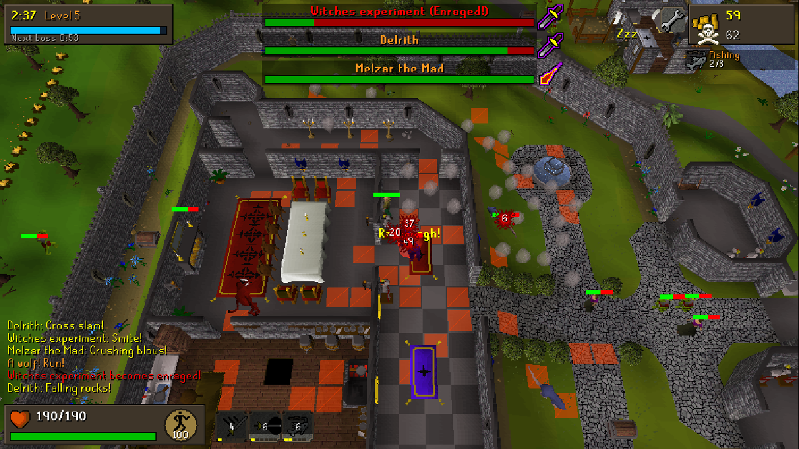

# Gielinor Survivors

A Vampire Survivors / Azeroth Survivors–style roguelike played in the authentic 2004 RuneScape
client: the [Lost City](https://github.com/LostCityRS) TypeScript web client renders it, and an
in-page simulation (a Web Worker) stands in for the game server. Tick-based, tile-based, real map
areas, real NPCs, real interfaces. **Local prototype** – it runs entirely in your browser from a
static folder; there is no server, login or account.



## Play (from a clean clone)

Requirements: Node.js 22+ and Git. The setup step downloads the Lost City engine + content
(the 2004 cache sources, ~120 MB) and builds the cache with the engine's own packer.

```sh
git clone -b claude/gielinor-survivors-8mw257 https://github.com/Spencer0/RuneScape-Survivors
cd RuneScape-Survivors
npm install
npm run setup      # fetch Lost City engine+content (pinned commits), pack cache, extract arenas/data
npm run build      # -> dist/ (a fully static site)
npm run serve      # http://localhost:8080  (or serve dist/ with any static file server)
```

Open the URL in Chrome. That's it – the page goes straight to the main screen.

Other commands:

| Command | What it does |
|---|---|
| `npm run sim` | Headless simulation: 500 bot runs across all classes/zones, the perfect-dodger vs telegraph-ignorer boss study, and a balance report (`sim-out/report.md`). |
| `npm run sim -- --one melee lumbridge dodger 7` | One headless run, printed as JSON. |
| `npm run extract` | Re-run data extraction (after changing arena definitions). |
| `npm run typecheck` | TypeScript checks for client + simulation. |

## Controls

| Action | Mouse / keyboard | Touch |
|---|---|---|
| Walk | Left-click any tile (every click is "walk here") | Tap a tile |
| Run on/off | Click the run-energy orb, or `X` | Tap the orb |
| Zoom | Mouse wheel | Pinch |
| Rotate / pitch camera | Middle-mouse drag, or arrow keys | One- or two-finger drag |
| Level-up cards | `1`–`4` or click; `R` reroll, `S` skip for coins, `B` banish | Tap |
| Pause / options | `Esc` or the wrench button | Wrench button |
| FPS / entity / tick overlay | `F` | Options |
| Start run on the main screen | `Enter` or **Enter World** | Tap **Enter World** |

The game works in landscape and portrait on desktop and mobile: the client picks a logical
resolution from the window (503 px tall in landscape, like the 765×503 applet; the real screen
width in portrait) and scales it to fill the screen.

## What's in it

- **3 classes** (Melee, Ranged, Magic) with 8 class abilities each (6 ranks), talent trees with
  milestones and capstones that change the starting ability, and bronze → rune gear per class.
- **13 skill card families** – every 2004 non-combat skill plus Prayer – each with 3 cards
  (5 ranks) and set bonuses at 3/6/10 ranks.
- **3 zones on the real 2004 map**: Lumbridge, Edgeville Dungeon and the Deep Wilderness (Demonic
  Ruins), each with a native roster, 5 bosses at 3/6/9/12/16 minutes with telegraphed tile attacks
  and enrage, sleeping guardians, cost-to-open caches, coins, rerolls, magnets and endless mode.
- **Meta-progression**: talent XP per class, per-class zone unlocks, gear collection, account-wide
  rewards bought with achievement points (rerolls, banish, opening hand, pet kitten),
  15 achievements. Saved in IndexedDB; Export/Import under Options.

See [NOTES.md](NOTES.md) for the design mapping, every client change, the balance report and known
issues.

## Debug URL parameters (testing only)

`?autostart=1&class=ranged&zone=lumbridge` start a run immediately · `&seed=N` fixed seed ·
`&bossat=1,2,3,4,5` boss minutes · `&debugmax=1` max talents · `&horde=200` force horde size ·
`&bot=dodger` let the headless bot play in the browser · `&speed=4` faster ticks.

## Licence / assets

Code from Lost City is MIT (see `client/LICENSE`). The game assets are the intellectual property of
Jagex Ltd. and are fetched from the Lost City content repository at setup time; the source branches
of this repository don't contain them (the `gh-pages` beta branch holds a built copy so the game can
be played on GitHub Pages).
